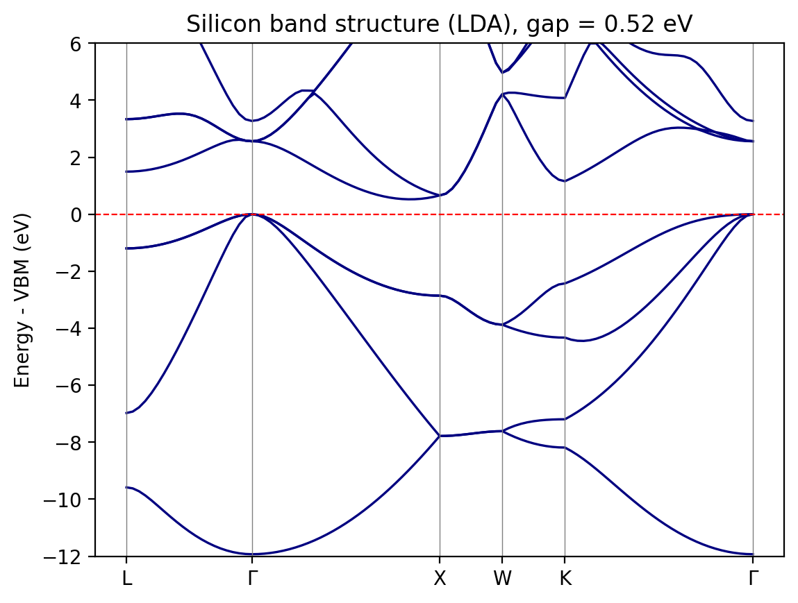

# DFT Study of Silicon Band Structure using Quantum ESPRESSO

## Aim
To calculate the electronic band structure and density of states of crystalline silicon using density functional theory, and to compare the computed band gap with published values.

## Tools
Quantum ESPRESSO, BURAI, VESTA, and Python with NumPy and Matplotlib.

## Planned Steps
First, convergence tests for cutoff energy and k-points. Second, self-consistent calculation. Third, band structure and density of states. Fourth, comparison with literature.

## Status
SCF calculation is completed, converged in six iterations. Convergence tests, band structure and density of states calculation is also completed.

## Author
Rizwan Haider, BS Physics, Thal University Bhakkar

## Results

Settings (from convergence tests): plane-wave cutoff 40 Ry, k-point grid 6x6x6. Total energy changes by less than 1 mRy between neighbouring cutoffs from 40 Ry, and between neighbouring grids from 4x4x4.

Band structure: path L-Gamma-X-W-K-Gamma.

| Quantity | Value |

| Indirect band gap (LDA) | 0.52 eV |
| Valence band maximum | at Gamma |
| Conduction band minimum | along Gamma-X |
| Minimum direct gap | 2.56 eV |
| Experimental indirect gap | 1.12 eV |

##Note: the calculated gap is about half the experimental value. This is the known underestimation of band gaps by LDA, not an error in the setup.

## Files
- `si.ec*.in/out`: cutoff convergence test
- `si.k*.in/out`: k-point convergence test
- `si.scf.final.in/out`: final self-consistent calculation
- `si.bands.in/out`: band structure calculation
- `gap.py`, `plot_bands.py`: scripts for the gap and the plot

  ## Density of states:
  non-self-consistent run on a 12x12x12 grid with the tetrahedron method, then dos.x.

The zero-DOS window is 0.54 eV wide, consistent with the 0.52 eV indirect gap from the band structure (the difference is about one DOS energy step of 0.02 eV).

## Comparison with literature

Calculations were performed with Quantum ESPRESSO [5-7] (version 7.4.1, compiled from source) using the norm-conserving LDA pseudopotential Si.pz-vbc.UPF [8] (Perdew-Zunger functional [4]; the file header lists no author), a plane-wave cutoff of 40 Ry, a 6x6x6 k-point grid, and the experimental lattice constant of 10.26 bohr [3].

| Quantity | This work (LDA) | Published LDA [1] | Experiment, ~10 K [2] |
|---|---|---|---|
| Indirect gap | 0.52 eV | 0.463 eV | 1.17 eV |
| Direct gap at Gamma | 2.56 eV | 2.567 eV | 3.378 eV |

The indirect gap is underestimated by about 55 percent relative to experiment, which is the known behaviour of LDA. The published calculation [1] used ABINIT with a Troullier-Martins pseudopotential, the Perdew-Wang LDA, a 20 Ha (40 Ry) cutoff and a relaxed lattice constant of 10.170 bohr. Differences from the values above are likely due to the pseudopotential and the lattice constant. The conduction band minimum lies on the Gamma-X line at about 0.83 of the way to X (published: 0.848 [1]); the difference is limited by the k-path resolution used here.

## References

[1] S. Poncé, Y. Gillet, J. Laflamme Janssen, A. Marini, M. Verstraete, and X. Gonze, J. Chem. Phys. 143, 102813 (2015), doi:10.1063/1.4927081; erratum: J. Chem. Phys. 146, 099901 (2017).

[2] G. E. Jellison and F. A. Modine, Phys. Rev. B 27, 7466 (1983).

[3] R. W. G. Wyckoff, Crystal Structures, Vol. 1 (John Wiley & Sons, 1963).

[4] J. P. Perdew and A. Zunger, Phys. Rev. B 23, 5048 (1981).

[5] P. Giannozzi et al., J. Phys.: Condens. Matter 21, 395502 (2009).

[6] P. Giannozzi et al., J. Phys.: Condens. Matter 29, 465901 (2017).

[7] P. Giannozzi et al., J. Chem. Phys. 152, 154105 (2020).

[8] Quantum ESPRESSO pseudopotential library, file Si.pz-vbc.UPF, https://pseudopotentials.quantum-espresso.org/upf_files/Si.pz-vbc.UPF (accessed November 2026).
