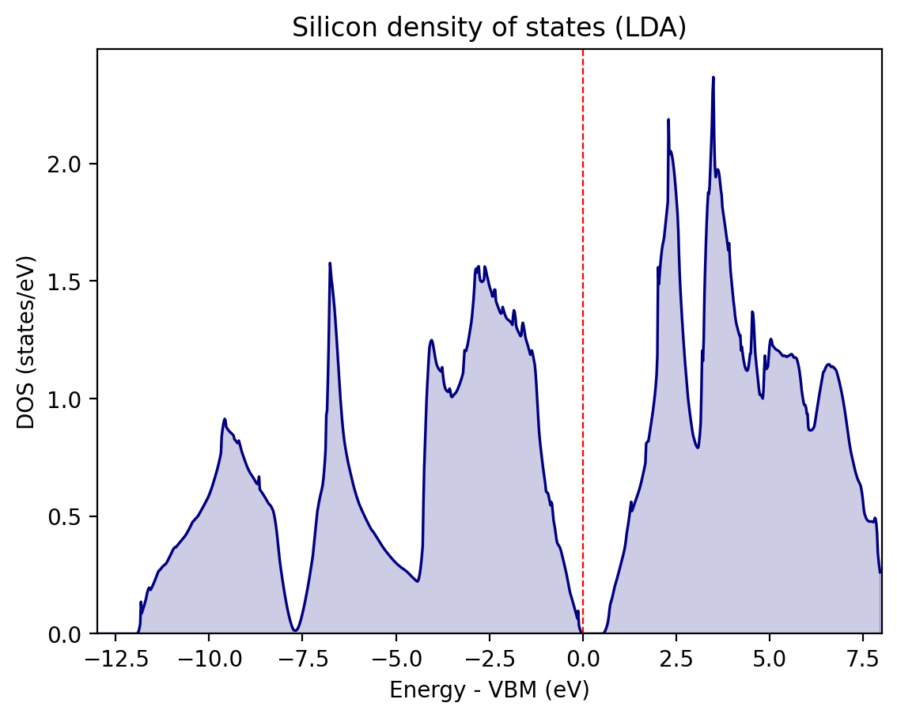

# Electronic Structure of Crystalline Silicon from DFT (Quantum ESPRESSO)

*Self-directed learning project, November 2026. Author: Rizwan Haider, BS Physics, Thal University Bhakkar, Pakistan.*

This project reproduces a standard benchmark calculation, the band structure and density of states of silicon in the local density approximation (LDA), to build practical skills in plane-wave density functional theory. It is not new research. The results are compared with a published calculation and with experiment.

## Key results

| Quantity | This work (LDA) | Published LDA [1] | Experiment, ~10 K [2] |
|---|---|---|---|
| Indirect gap | 0.52 eV | 0.463 eV | 1.17 eV |
| Direct gap at Γ | 2.56 eV | 2.567 eV | 3.378 eV |

## Method

- **Code:** Quantum ESPRESSO 7.4.1 [5-7], compiled from source (the packaged Ubuntu version crashed on start-up on this system). Run on Ubuntu 24.04 (WSL2) on a laptop with 8 GB RAM.
- **Functional and pseudopotential:** LDA (Perdew-Zunger [4]), norm-conserving Si.pz-vbc.UPF [8] (the file header lists no author).
- **Structure:** diamond structure (fcc lattice, 2 atoms per cell), experimental room-temperature lattice constant 10.26 bohr (as cited in [1] from [3]), not optimised.
- **Computational details:** wavefunction cutoff 40 Ry (norm-conserving pseudopotential, default charge-density cutoff of 4 times that); SCF threshold 1e-8 Ry; fixed occupations for the SCF and band runs. SCF and convergence tests use shifted Monkhorst-Pack grids [9] (offset 1 1 1): 4x4x4 for the cutoff test, 6x6x6 for the final run. The band run uses 8 bands along 101 k-points with verbosity = 'high' so that all eigenvalues are printed. The DOS run (non-self-consistent) uses an unshifted 12x12x12 grid (72 irreducible k-points), the tetrahedron method [10] and an energy step of 0.02 eV. Analysis with Python 3, NumPy and Matplotlib; dos.x was built with make pp.
- **Workflow:** convergence tests, final self-consistent (SCF) run, band structure, non-self-consistent run on a denser grid, density of states.

## Convergence tests

Plane-wave cutoff (k-grid 4x4x4):

| Cutoff (Ry) | Total energy (Ry) | Change (mRy) |
|---|---|---|
| 20 | -15.84736537 | - |
| 30 | -15.85199855 | 4.63 |
| 40 | -15.85286448 | 0.87 |
| 50 | -15.85318059 | 0.32 |
| 60 | -15.85324038 | 0.06 |

k-point grid (cutoff 40 Ry):

| Grid | Total energy (Ry) | Change (mRy) |
|---|---|---|
| 2x2x2 | -15.84085914 | - |
| 4x4x4 | -15.85286448 | 12.01 |
| 6x6x6 | -15.85306062 | 0.20 |
| 8x8x8 | -15.85306812 | 0.0075 |
| 10x10x10 | -15.85306798 | 0.00014 (absolute) |

Selected settings: **cutoff 40 Ry, k-grid 6x6x6**. The criterion was a total-energy change below 1 mRy between neighbouring settings.

## Band structure

Path: L-Γ-X-W-K-Γ (101 k-points).


- Valence band maximum at Γ (6.0448 eV).
- Conduction band minimum on the Γ-X line, at about 0.83 of the way to X.
- Indirect gap 0.5246 eV; minimum direct gap 2.5618 eV, located at Γ.

## Density of states

Non-self-consistent run on a 12x12x12 grid with the tetrahedron method, then dos.x.



The zero-DOS window is 0.54 eV wide, consistent with the 0.52 eV indirect gap from the band structure (the difference is about one DOS energy step of 0.02 eV).

## Comparison with literature

The calculated indirect gap is about 55 percent below experiment. This is the known underestimation of band gaps by LDA, not an error in the setup. The published calculation [1] used ABINIT with a Troullier-Martins pseudopotential, the Perdew-Wang LDA, a 20 Ha (40 Ry) cutoff and a relaxed lattice constant of 10.170 bohr. Differences from the values above are likely due to the pseudopotential and the lattice constant. The conduction band minimum is at about 0.83 of the way along Γ-X (published: 0.848 [1]); the difference is limited by the k-path resolution used here.

## Scope and limitations

- Non-spin-polarised LDA calculations at 0 K with a static lattice; the lattice constant was not optimised. The experimental gaps in the table are measured at about 10 K, while the lattice constant is a room-temperature value.
- Electron-phonon (zero-point) renormalisation of the gap, the subject of [1], is not included, and no many-body (GW) or hybrid-functional correction was applied.
- Convergence was tested on the total energy; the convergence of the band gap itself with cutoff and k-grid was not tested.
- The band path has 101 k-points, which limits the precision of the conduction band minimum position.
- The DOS uses a 12x12x12 grid; the small spikes in the curve are numerical.
- Valence bandwidth and effective masses were not compared with published values.
- The pseudopotential Si.pz-vbc.UPF is norm-conserving LDA; its file header lists no author. The pseudopotential file is not included in this repository; download it from [8] into ../pseudo.

## Files

- `si.scf.in/out`: first test run (30 Ry, 4x4x4)
- `si.ec*.in/out`: cutoff convergence test
- `si.k*.in/out`: k-point convergence test
- `si.scf.final.in/out`: final self-consistent calculation
- `si.bands.in/out`: band structure calculation
- `si.nscf.in/out`: non-self-consistent calculation for the DOS
- `si.dos.in/out`, `si.dos`: dos.x input, output and data
- `gap.py`, `plot_bands.py`, `plot_dos.py`: analysis and plotting scripts
- `si_bands.png`, `si_dos.png`: figures

## How to reproduce

Place Si.pz-vbc.UPF (see [8]) in ../pseudo relative to the calculation folder. The convergence-test inputs (si.ec*.in, si.k*.in) were made from si.scf.in by changing ecutwfc and the k-grid. si.scf.final must run first, because the band and DOS runs reuse its data (same prefix and outdir).

```
pw.x < si.scf.final.in > si.scf.final.out
pw.x < si.bands.in > si.bands.out
python3 gap.py
python3 plot_bands.py
pw.x < si.nscf.in > si.nscf.out
dos.x < si.dos.in > si.dos.out
python3 plot_dos.py
```

## Acknowledgements

The workflow was guided with the help of an AI assistant (Claude, Anthropic). All calculations were run by the author.

## References

[1] S. Poncé, Y. Gillet, J. Laflamme Janssen, A. Marini, M. Verstraete, and X. Gonze, J. Chem. Phys. 143, 102813 (2015), doi:10.1063/1.4927081; erratum: J. Chem. Phys. 146, 099901 (2017).

[2] G. E. Jellison and F. A. Modine, Phys. Rev. B 27, 7466 (1983).

[3] R. W. G. Wyckoff, Crystal Structures, Vol. 1 (John Wiley & Sons, 1963).

[4] J. P. Perdew and A. Zunger, Phys. Rev. B 23, 5048 (1981).

[5] P. Giannozzi et al., J. Phys.: Condens. Matter 21, 395502 (2009).

[6] P. Giannozzi et al., J. Phys.: Condens. Matter 29, 465901 (2017).

[7] P. Giannozzi et al., J. Chem. Phys. 152, 154105 (2020).

[8] Quantum ESPRESSO pseudopotential library, file Si.pz-vbc.UPF, https://pseudopotentials.quantum-espresso.org/upf_files/Si.pz-vbc.UPF (accessed November 2026).

[9] H. J. Monkhorst and J. D. Pack, Phys. Rev. B 13, 5188 (1976).

[10] P. E. Blöchl, O. Jepsen, and O. K. Andersen, Phys. Rev. B 49, 16223 (1994).
